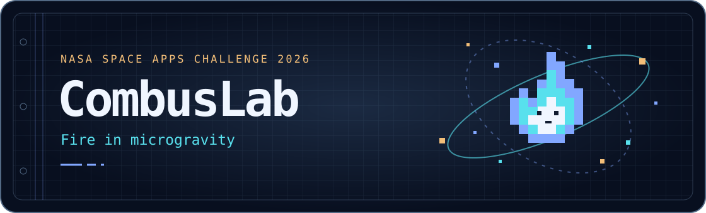
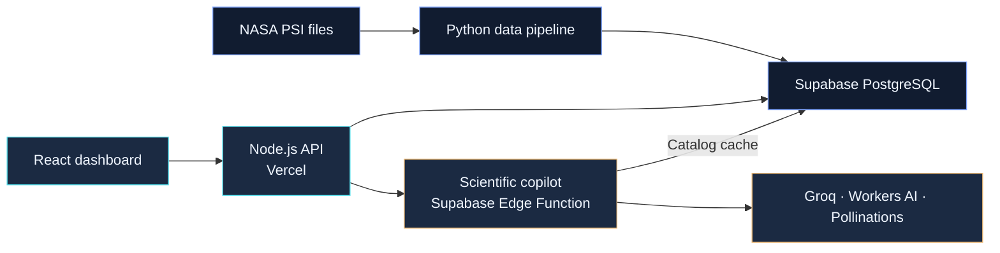

<p align="center">
  
</p>

<p align="center">
  
</p>

<h1 align="center">CombusLab</h1>

<p align="center"><strong>A field notebook for fire in microgravity</strong></p>

<p align="center">
  <a href="https://combuslab.vercel.app/"><strong>Open the dashboard</strong></a> ·
  <a href="https://combuslab.vercel.app/flight-notebook"><strong>Try Flight Notebook</strong></a> ·
  <a href="https://www.spaceappschallenge.org/2026/challenges/flame-in-freefall/">NASA Space Apps Challenge</a>
</p>

<p align="center">
  <a href="#start-with-a-question">Try it</a> ·
  <a href="#explore-the-lab">Features</a> ·
  <a href="#data-and-nasa-sources">NASA data</a> ·
  <a href="#architecture-and-technology">Tech stack</a> ·
  <a href="#run-locally">Run locally</a>
</p>

---

## Project summary

CombusLab is an interactive research dashboard built for the 2026 NASA Space Apps Challenge, *Flame in Freefall*. It brings NASA microgravity combustion records into one place so students, researchers, and curious explorers can see how flames behave when gravity and airflow differ from everyday experience. Users can inspect synchronized gas readings, compare documented trial conditions, rank investigations for a fire-safety scenario, and ask a scientific copilot to explain the evidence with NASA citations. Flight Notebook turns a real SAFFIRE comparison into a guided investigation. Visitors follow published flame-front images, choose what they would measure next, and download an evidence note with their own observations. By making experimental conditions, missing measurements, and sources visible, CombusLab helps people find evidence relevant to spacecraft fire-safety questions and see where further testing is needed for future missions to the Moon and Mars.

## Start with a question

| I want to know… | Where to start |
| --- | --- |
| How do the published flame fronts look under two airflow conditions? | Open [Flight Notebook](https://combuslab.vercel.app/flight-notebook) and step through the SAFFIRE case. |
| Do two trials share a material or similar gas conditions? | Open [Compare](https://combuslab.vercel.app/compare?a=PSI-98%3AS1%3Ar2&b=PSI-100%3AS1%3Ar2) with the SAFFIRE pair preselected. |
| Which experiments could inform a lunar habitat question? | In [Ranking](https://combuslab.vercel.app/ranking), select the lunar preset and inspect the evidence behind each match. |
| Can I take the measurements into my own analysis? | Open [Data Lab](https://combuslab.vercel.app/data-lab?experiment_id=PSI-100%3AS1%3Ar2), select the channel and time window, then export CSV or JSON. |

## Explore the lab

| View | What you can do |
| --- | --- |
| **Dashboard and Discover** | Inspect SAFFIRE oxygen and carbon dioxide time series, search experiments by material or conditions, and view trial metadata and sources. |
| **Compare** | Compare trials across SAFFIRE and BASS. Overlay gas readings when both trials have documented compatible units and time references. Each trial's clock starts at its first calibrated reading. |
| **Ranking and Safety Insights** | Match documented trial conditions to adjustable spacecraft, lunar, or Martian scenarios. See which criteria match, differ, or lack evidence. Scores measure relevance to the selected scenario. |
| **Data Lab** | Inspect candidate variables and export available series or experimental conditions as CSV or JSON. |
| **Flight Notebook** | Step through NASA's published SAFFIRE-I and SAFFIRE-III flame-front composites, compare gas readings, and download a Markdown evidence note with your proposed next measurement. |
| **Scientific copilot** | Open the pixel-art copilot from any view, ask a follow-up about the active study or chart, and inspect NASA citations. The dashboard and copilot are public. |
| **Resources** | Browse the NASA research library and see which investigations have integrated records, partial coverage, or external datasets. |

## Inside Flight Notebook

<table>
  <tr>
    <td align="center" width="138">
      
    </td>
    <td>
      <strong>Same fabric, different airflow.</strong><br>
      Follow the published flame fronts from SAFFIRE-I and SAFFIRE-III. Inspect the oxygen and carbon dioxide traces, then ask the copilot to explain the chart you have open.
    </td>
  </tr>
</table>

1. **Observe.** Step through NASA's composite images. The source images were taken 40 seconds apart.
2. **Compare.** Open both trials side by side and check which conditions differ.
3. **Record.** Choose what to measure next and save a Markdown evidence note with your own observations.

## Design and development

We designed Flight Notebook around a question a visitor could investigate in a few minutes. How does changing airflow affect flame spread over the same fabric? Flight Notebook makes that question hands-on. A pixel-art flame marks the selected front in the published images, and the downloadable note captures the visitor's choice of measurement, their observations, and an open research question. The same trial pair opens directly in Compare. The visual identity combines a small pixel-art crew member with an orbital backdrop. The interface supports keyboard input and reduced motion.

We prioritized sources with documented units, usable clocks, and trial-level provenance. The pipeline checks for duplicates and preserves missing values. Flight Notebook labels the published image interval separately from the instrument clocks because alignment between them has not been verified. Coverage varies by experiment, so comparison and ranking expose gaps instead of assuming equivalent conditions. The copilot retrieves evidence before calling a model and distinguishes insufficient evidence from questions outside its scope. The hardware behind the measurements was NASA's flight experiment equipment. Our team developed the software and worked with published data.

## How the copilot follows the evidence

1. Open the pixel-art copilot from the view you are exploring. The chat receives the current trial, dataset, chart channel and time window when those selections are available.
2. Ask **“Explain this chart”** or start with a study, for example **“What does SAFFIRE-I study?”** Then ask **“Which datasets?”** to continue on the same subject.
3. Check the linked NASA citations and distinguish the recorded measurements from the calculations and comparisons used to explain them.

The chat is public. Minimizing it keeps the draft and conversation in the browser. The trash button clears both and cancels a pending request. The shared cache holds catalog evidence for five minutes. Each conversation remains in its own browser session.

## How to interpret the results

| What the app shows | What to check before drawing a conclusion |
| --- | --- |
| A gas-series overlay | Both trials must have readings in compatible units and time references. Each zero is the first calibrated record of its own trial. |
| A scenario ranking | Each selected criterion has equal weight. Missing criteria stay in the denominator, so a score describes how much documented evidence matches the scenario. |
| Flame-front images alongside gas charts | NASA's published composites and the gas traces use separate time references. The images illustrate the progression of the front and the gas charts show measured concentrations. |
| Blank or unavailable values | A blank means a usable value is missing. Check the source and coverage before using the data in a calculation or model. |

## Data and NASA sources

The [dataset guide](datasets/README.en.md) documents the processing pipeline, source versions and DOIs. The integrated master has **420,421 rows** and the synchronized measurements table has **226,124 unique rows**. These figures describe different processing stages. The dashboard exposes selected channels with documented units.

| Coverage in CombusLab | NASA source |
| --- | --- |
| Integrated trial metadata and synchronized gas readings where available | [SAFFIRE-I · PSI-98](https://psi.nasa.gov/physci/repo/data/investigations/PSI-98), [SAFFIRE-II · PSI-99](https://psi.nasa.gov/physci/repo/data/investigations/PSI-99), [SAFFIRE-III · PSI-100](https://psi.nasa.gov/physci/repo/data/investigations/PSI-100) |
| Integrated trial metadata and reported conditions where available | [BASS · PSI-26](https://psi.nasa.gov/physci/repo/data/investigations/PSI-26), [BASS-II · PSI-25](https://psi.nasa.gov/physci/repo/data/investigations/PSI-25) |
| Test-day counts for the ACME CLD Flame subset | [CLD Flame · PSI-21](https://psi.nasa.gov/physci/repo/data/investigations/PSI-21) |
| Published images and experimental context for Flight Notebook | [SAFFIRE flame-front composites · slide 17](https://ntrs.nasa.gov/api/citations/20180004258/downloads/20180004258.pdf#page=17) |
| External references and datasets indexed in Resources | [FLEX · PSI-69](https://psi.nasa.gov/physci/repo/data/investigations/PSI-69), [SPICE · PSI-107](https://psi.nasa.gov/physci/repo/data/investigations/PSI-107), [SAME · PSI-102](https://psi.nasa.gov/physci/repo/data/investigations/PSI-102), [ACME](https://science.nasa.gov/mission/acme/), [SoFIE](https://science.nasa.gov/biological-physical/investigations/sofie/) |

The [Physical Sciences Informatics (PSI) combustion index](https://www.nasa.gov/physical-sciences-informatics-psi/psi-investigations-by-research-area/) is the primary route to the original measurement files. The [NASA Technical Reports Server (NTRS)](https://ntrs.nasa.gov/) provides reports and figures used for scientific context. Related discovery portals include the [NASA Open Data Portal](https://data.nasa.gov/), the [NASA Open Science Data Repository (OSDR)](https://science.nasa.gov/biological-physical/data/osdr/), and the [NASA Open Source Software Catalog](https://github.com/nasa/Open-Source-Catalog). The measurement imports in the table are attributed to their PSI records.

## Architecture and technology

CombusLab uses a **modular monolith** for the dashboard and scientific API. Vercel deploys them together. The Node.js API serves the catalog, trial metadata, series, and exports through same-origin routes backed by read-only PostgreSQL queries. The scientific copilot routes through a Supabase Edge Function. The backend calculates and validates the evidence and citations, while the model selects and orders supported observations. A private, five-minute Supabase cache stores public catalog evidence. Recent conversation context stays in the browser, and the trash button clears it. A server-side backup can return evidence when the Edge Function is unavailable.



| Layer | Stack |
| --- | --- |
| Front end | React, TypeScript, Vite, React Router, Tailwind CSS, Chart.js, Lucide |
| API and hosting | Node.js 24, Vercel Functions |
| Storage and AI | Supabase PostgreSQL, Supabase Edge Functions running Deno, Groq, Cloudflare Workers AI, Pollinations AI |
| Dataset preparation | Python, pandas, NumPy, DuckDB, PyArrow, Pint, Pandera |
| Quality and observability | Vitest, Husky, Python test suites, Sentry |

### AI tools used

| Where | Tools |
| --- | --- |
| Development and iteration | Google Gemini, Anthropic Claude, and OpenAI Codex |
| Copilot at runtime | Groq, Cloudflare Workers AI, and Pollinations AI |

## Verification

- **Data preparation.** The pipeline checks source versions and hashes, units, unique trial and timestamp keys, and clock alignment before exporting the synchronized table.
- **API and evidence.** The Vitest suite covers export semantics, chart interpretation, comparisons, citations, conversation follow-ups, and cache fallback. Husky runs it before commits.
- **Chart fidelity.** The [developer guide](Changeme_Nasa/README.md#testing-and-error-monitoring) shows how to compare an API window with the reference DuckDB file, including timestamps, units, readings, and null positions.

## Run locally

Use Node.js 24. From the repository root, install both packages.

```sh
npm ci --prefix Changeme_Nasa
npm ci --prefix Changeme_Nasa/dashboard
```

Start the API and the front end in separate terminals.

```sh
npm run api --prefix Changeme_Nasa
npm run dev --prefix Changeme_Nasa/dashboard
```

Open `http://localhost:5173`. Vite forwards `/api` requests to port `8787`. The [developer guide](Changeme_Nasa/README.md) covers environment variables, data access, and deployment. The [dataset guide](datasets/README.en.md) covers Python setup and data reproduction.

```sh
npm test --prefix Changeme_Nasa
npm run build --prefix Changeme_Nasa/dashboard
```
